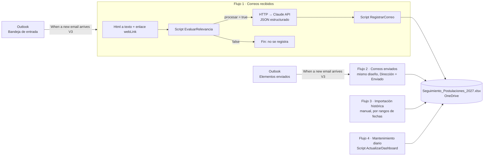

# Diseño de los flujos de Power Automate

> **Estado:** este diseño **no se ha configurado ni probado en tu cuenta**. Las piezas que se probaron aquí son la lógica de los Office Scripts (con un libro simulado) y las fórmulas del Excel (ver `04_pruebas.md`). Los flujos funcionarán recién cuando los crees y completes la prueba controlada de `01_configuracion.md`, paso 8.

## Arquitectura



Principios:

- **Solo lectura del correo.** Ningún flujo envía, mueve, marca ni modifica correos. La única acción de Outlook además del disparador es *Send an HTTP request* con `GET` (lectura de `webLink`).
- **La lógica está en Excel, no en el flujo.** Toda decisión (deduplicación, vínculo con la postulación, umbrales, reglas de estado) la toman los Office Scripts, que leen los catálogos y parámetros del propio archivo. El flujo solo transporta datos. Así puedes cambiar reglas desde Excel sin editar el flujo.
- **Un correo a la vez.** Control de simultaneidad del disparador = 1 para evitar que dos ejecuciones escriban la misma fila.
- **La IA propone y el script decide.** Si Claude falla, no responde o devuelve algo inválido, el script clasifica con reglas, que son más conservadoras (más casos van a Pendientes).

## Conectores y licencias

| Paso | Conector / acción | Licencia |
|---|---|---|
| Disparador | Office 365 Outlook · *When a new email arrives (V3)* | Estándar |
| Enlace al correo | Office 365 Outlook · *Send an HTTP request* (GET a Microsoft Graph) | Estándar (acción en vista previa) |
| Texto plano | Content Conversion · *Html to text* | Estándar |
| Scripts | Excel Online (Business) · *Run script* | Estándar. El archivo debe estar en **OneDrive para el trabajo o la escuela** o SharePoint |
| Clasificación con IA | HTTP · *HTTP* (POST a `api.anthropic.com`) | **Premium** |
| Avisos | Notifications · *Send me a mobile notification* | Estándar |

Sin licencia Premium, el sistema funciona en **modo reglas**: omite el bloque HTTP y pasa `clasificacionJson` vacío. Las confirmaciones claras se registran solas; los avances, ofertas y rechazos siempre quedan en Pendientes para que los confirmes.

## Flujo 1 · «Postulaciones – correos recibidos»

**Disparador:** *When a new email arrives (V3)*
- Folder: `Inbox`
- Include Attachments: `No` · Only with Attachments: `No` · Importance: `Any`
- Configuración → **Concurrency control: On, Degree of parallelism = 1**.
- *Split On* activado (es el valor por defecto).

> Si usas reglas de Outlook que mueven correos a otras carpetas, el disparador no los ve: crea una copia del flujo por carpeta o ajusta la regla.

Todo lo que sigue va dentro de un **Ámbito (Scope) «Try»**. Después agrega un Ámbito **«Catch»** configurado para ejecutarse si Try *ha fallado* o *ha agotado el tiempo de espera* (ver *Gestión de errores*).

### 1. Html to text → `Html_a_texto`
- Content: `triggerOutputs()?['body/body']`

### 2. Compose → `Texto_recortado`
```
substring(body('Html_a_texto'), 0, min(length(body('Html_a_texto')), 12000))
```

### 3. Send an HTTP request (Office 365 Outlook) → `Obtener_enlace`
- Method: `GET`
- URI: `https://graph.microsoft.com/v1.0/me/messages/@{triggerOutputs()?['body/id']}?$select=webLink,from`
- Configuración: **Retry policy: None**. Este paso es opcional; si falla, se usa un enlace alternativo.

### 4. Compose → `Datos_correo`
Configurar *Run after* = **is successful, has failed, is skipped** respecto de `Obtener_enlace`. Contenido (objeto JSON; cada valor es una expresión):

| Campo | Expresión |
|---|---|
| `idMensaje` | `coalesce(triggerOutputs()?['body/internetMessageId'], triggerOutputs()?['body/id'])` |
| `idGraph` | `triggerOutputs()?['body/id']` |
| `idConversacion` | `triggerOutputs()?['body/conversationId']` |
| `fecha` | `convertTimeZone(triggerOutputs()?['body/receivedDateTime'], 'UTC', 'Pacific SA Standard Time', 'yyyy-MM-ddTHH:mm:ss')` |
| `ahora` | `convertTimeZone(utcNow(), 'UTC', 'Pacific SA Standard Time', 'yyyy-MM-ddTHH:mm:ss')` |
| `remitenteNombre` | `coalesce(body('Obtener_enlace')?['from']?['emailAddress']?['name'], triggerOutputs()?['body/from'])` |
| `remitenteCorreo` | `triggerOutputs()?['body/from']` |
| `destinatarios` | `triggerOutputs()?['body/toRecipients']` |
| `asunto` | `triggerOutputs()?['body/subject']` |
| `extracto` | `outputs('Texto_recortado')` |
| `enlace` | `coalesce(body('Obtener_enlace')?['webLink'], concat('https://outlook.office.com/mail/deeplink/read/', encodeUriComponent(triggerOutputs()?['body/id'])))` |
| `direccion` | `Recibido` (texto fijo) |

> **ID del mensaje:** se usa `internetMessageId` porque es estable aunque el correo se mueva de carpeta. El `id` de Graph cambia al mover el correo, así que el enlace guardado puede dejar de abrirse si archivas el mensaje después. En ese caso, busca por asunto y fecha (ambos quedan en el historial).

### 5. Run script → `EvaluarRelevancia`
- Location: `OneDrive for Business` · Document Library: `OneDrive` · File: `/Postulaciones/Seguimiento_Postulaciones_2027.xlsx`
- Script: `EvaluarRelevancia`
- `correoJson`: `string(outputs('Datos_correo'))`

### 6. Condition → `¿Procesar?`
`body('EvaluarRelevancia')?['result']?['procesar']` **is equal to** `true`

**Si no:** termina (el correo no se registra).

**Si sí:**

#### 6.1 Scope `Clasificar_con_Claude` (solo con licencia Premium)

1. **Compose `Prompt_sistema`**: pega el contenido completo de `power-automate/prompt_sistema.txt`.
2. **Compose `Plantilla_cuerpo`**: pega el contenido de `power-automate/plantilla_cuerpo_claude.json` (es JSON; el diseñador lo guarda como objeto).
3. **Compose `Mensaje_usuario`** (texto):
   ```
   Dirección: @{outputs('Datos_correo')?['direccion']}
   Fecha: @{outputs('Datos_correo')?['fecha']}
   Remitente: @{outputs('Datos_correo')?['remitenteNombre']} <@{outputs('Datos_correo')?['remitenteCorreo']}>
   Para: @{outputs('Datos_correo')?['destinatarios']}
   Asunto: @{outputs('Datos_correo')?['asunto']}

   Texto del correo:
   <<<
   @{outputs('Datos_correo')?['extracto']}
   >>>

   @{body('EvaluarRelevancia')?['result']?['contextoIA']}
   ```
4. **HTTP → `Llamar_Claude`**
   - Method: `POST` · URI: `https://api.anthropic.com/v1/messages`
   - Headers:
     | Clave | Valor |
     |---|---|
     | `x-api-key` | tu clave de API (ver `01_configuracion.md`, paso 4) |
     | `anthropic-version` | `2026-10-21` |
     | `anthropic-beta` | `server-side-fallback-2026-07-01` |
     | `content-type` | `application/json` |
   - Body: **una sola expresión** (pestaña *Expresión*), para que el texto del correo quede bien escapado:
     ```
     setProperty(setProperty(outputs('Plantilla_cuerpo'), 'system', createArray(addProperty(json('{"type":"text","cache_control":{"type":"ephemeral"}}'), 'text', outputs('Prompt_sistema')))), 'messages', createArray(addProperty(json('{"role":"user"}'), 'content', outputs('Mensaje_usuario'))))
     ```
   - Configuración: **Secure inputs** y **Secure outputs** activados (la clave no queda visible en el historial). Retry policy: *Exponential*, 4 reintentos. Timeout: `PT2M`.
5. **Filter array → `Bloques_texto`**: From `body('Llamar_Claude')?['content']`; condición `item()?['type']` *is equal to* `text`.
6. **Compose → `Clasificacion_texto`**:
   ```
   if(equals(body('Llamar_Claude')?['stop_reason'], 'end_turn'), first(body('Bloques_texto'))?['text'], '')
   ```
   Si el modelo se detuvo por otro motivo (`max_tokens`, `refusal`), se devuelve vacío y el script usa reglas.

#### 6.2 Run script → `RegistrarCorreo`
- *Run after* respecto del Scope `Clasificar_con_Claude`: **is successful, has failed, is skipped, has timed out**.
- Script: `RegistrarCorreo`
- `correoJson`: `string(outputs('Datos_correo'))`
- `clasificacionJson`: `coalesce(outputs('Clasificacion_texto'), '')`
  *(modo reglas sin Premium: escribe una expresión vacía `''`)*

#### 6.3 Avisos (opcional)
Condición: `body('RegistrarCorreo')?['result']?['accion']` es igual a `pendiente` → *Send me a mobile notification*: «Correo por revisar: @{outputs('Datos_correo')?['asunto']}».

### Gestión de errores (Scope «Catch»)
- *Run after* = Try **has failed / has timed out**.
- *Send me a mobile notification*:
  ```
  Error en flujo de postulaciones: @{outputs('Datos_correo')?['asunto']}
  @{concat('https://make.powerautomate.com/environments/', workflow()?['tags']?['environmentName'], '/flows/', workflow()?['name'], '/runs/', workflow()?['run']?['name'])}
  ```
- El correo no queda registrado si el script falla. Para recuperarlo, vuelve a enviar la ejecución desde el historial (*Resubmit*) o usa el Flujo 3 con ese rango de fechas: los duplicados se ignoran solos.

| Error típico | Causa | Qué hacer |
|---|---|---|
| `401` en `Llamar_Claude` | Clave de API inválida o revocada | Crea una nueva clave y actualiza el encabezado |
| `429` / `529` | Límite de uso o sobrecarga | Los reintentos automáticos lo resuelven; si persiste, el script usa reglas |
| `400` en `Llamar_Claude` | Plantilla mal pegada o modelo no disponible | Vuelve a pegar `plantilla_cuerpo_claude.json`; revisa el nombre del modelo |
| *Run script* `BadGateway` / tiempo agotado | Archivo abierto con bloqueo, formato ISO strict o > 120 s | Reintenta; no guardes el archivo como «Strict Open XML» |
| `No existe la tabla …` | Se renombró una tabla u hoja | Restaura el nombre (ver `03_mantenimiento.md`) |
| `La tabla … no tiene la columna «…»` | Se renombró una columna | Restaura el nombre exacto |

## Flujo 2 · «Postulaciones – correos enviados»

Copia del Flujo 1 (*Save As*) con estos cambios:
- Disparador: Folder = `Sent Items`.
- `Datos_correo.direccion` = `Enviado`.
- `Datos_correo.fecha` usa la misma expresión (`receivedDateTime` existe también en enviados).

Es la **única vía automática** para registrar «Postulación enviada» y llenar «Evidencia de envío».

## Flujo 3 · «Postulaciones – importación histórica» (manual)

**Disparador:** *Manually trigger a flow* con entradas de texto `desde` (AAAA-MM-DD), `hasta` (AAAA-MM-DD) y `carpeta` (`inbox` o `sentitems`).

1. **Initialize variable** `url` (String):
   ```
   concat('https://graph.microsoft.com/v1.0/me/mailFolders/', triggerBody()['text_2'], '/messages?$filter=receivedDateTime ge ', triggerBody()['text'], 'T00:00:00Z and receivedDateTime lt ', triggerBody()['text_1'], 'T00:00:00Z&$orderby=receivedDateTime asc&$top=25&$select=id,internetMessageId,conversationId,subject,from,toRecipients,receivedDateTime,body,webLink')
   ```
   (Ajusta `text`, `text_1`, `text_2` a los nombres internos de tus entradas.)
2. **Do until** `variables('url')` *is equal to* `''` (límite: 60 iteraciones).
   1. **Send an HTTP request** (Outlook) → `Pagina`: GET `@{variables('url')}`.
   2. **Apply to each** `body('Pagina')?['value']` con **Concurrency = 1**:
      - **Html to text** sobre `items('Apply_to_each')?['body']?['content']`.
      - **Compose `Datos_correo`** con las mismas claves del Flujo 1, tomando los valores de `items('Apply_to_each')`:
        `internetMessageId`, `id`, `conversationId`, `receivedDateTime`, `from/emailAddress/name`, `from/emailAddress/address`, `toRecipients` (`join(xpath(...))` o, más simple, `first(items('Apply_to_each')?['toRecipients'])?['emailAddress']?['address']`), `subject`, `webLink`; `direccion` = `if(equals(triggerBody()['text_2'],'sentitems'),'Enviado','Recibido')`.
      - El resto es igual al Flujo 1 desde el paso 5 (copia el Scope con *Copy to my clipboard*).
   3. **Set variable** `url` = `coalesce(body('Pagina')?['@odata.nextLink'], '')`.

Recomendaciones:
- Importa **un mes por ejecución**. Cada correo de la carpeta consume 1 ejecución de script (prefiltro) y los relevantes, 1 más; el límite es **1.600 ejecuciones de *Run script* por usuario al día** (se reinicia a las 00:00 UTC).
- Importa primero `sentitems` y luego `inbox` del mismo período: así las postulaciones enviadas existen antes de que lleguen sus confirmaciones.
- Puedes repetir un rango sin miedo: los mensajes ya registrados se omiten.

## Flujo 4 · «Postulaciones – mantenimiento diario»

- Disparador: *Recurrence* diario a las 07:40, zona horaria (UTC-04:00) Santiago.
- *Run script* `ActualizarDashboard` con `ahoraIso` = `convertTimeZone(utcNow(),'UTC','Pacific SA Standard Time','yyyy-MM-ddTHH:mm:ss')`.

Recalcula, ajusta rangos de gráficos, refresca tablas dinámicas y, si activaste `MarcarSinRespuestaAutomatico`, marca los procesos sin respuesta.

## Costos estimados de IA

Con `claude-opus-5-5` (US$4 por millón de tokens de entrada / US$20 de salida) y esfuerzo `low`: cerca de 4.000–6.000 tokens de entrada y 300–800 de salida por correo, es decir **≈ US$0,03 por correo clasificado**. Con 100 correos relevantes al mes, ≈ US$3/mes; una importación histórica de 500 correos relevantes, ≈ US$15. El prefiltro evita enviar a la IA los correos que no tienen señales de un proceso de selección. Si quieres reducir el costo, puedes cambiar `model` en la plantilla (por ejemplo, a `claude-haiku-5-5`) y validar con `tests/probar_clasificador.py` que la precisión te siga sirviendo.
